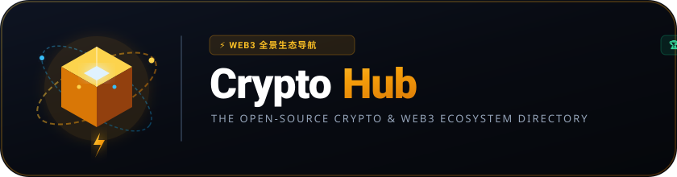

<p align="center">
  
</p>

<p align="center">
  <strong>极客加密资产与 Web3 全景导航开源项目 · 交易所置顶收录</strong>
</p>

<p align="center">
  <a href="LICENSE"></a>
  <a href="CONTRIBUTING.md"></a>
  
  
  
</p>

> 🎯 **CryptoHub** 是一个开源、中立、全面收录加密货币与区块链全生态核心工具的导航项目。**交易所与交易流动性生态置顶收录**，涵盖 CEX、DEX、主流公链、DeFi、专业行情图表、链上安全与开发者基建。所有收录项目均已在本地代码仓库 (`assets/logos/`) 收录高清图标并直接展示。

---

### 🛡️ 链上资金安全与防钓鱼特别提示
> ⚠️ **重要提醒**：加密行业钓鱼网站与恶意虚假推广猖獗。进入任何交易平台或连接钱包前，请务必核对浏览器地址栏域名是否完全匹配本项目收录的**官方权威域名**！严禁点击搜索广告（Ad Sponsored）及不明社群私聊链接。

---

## 📑 快速目录导航 (Table of Contents)

- [🏆 **交易所与交易生态 (置顶 Top)**](#exchanges) `(18款)`
- [🔐 **加密钱包与资产管理**](#wallets) `(9款)`
- [📊 **行情图表与专业数据分析**](#market_analytics) `(12款)`
- [🪙 **去中心化金融协议 (DeFi)**](#defi) `(8款)`
- [🌐 **主流公链与Layer 2**](#public_chains) `(11款)`
- [🔍 **区块链浏览器与监控**](#explorers) `(5款)`
- [🛡️ **安全审计与防钓鱼**](#security) `(5款)`
- [⚡ **投研工具与空投监控**](#research_alpha) `(6款)`
- [📰 **资讯快讯与研报社区**](#news_media) `(8款)`
- [💻 **开发者与Web3基础设施**](#developer_infra) `(6款)`
- [🤝 如何参与贡献与提交项目](#-如何贡献与提交项目)
- [💻 本地运行与静态网页部署](#-本地运行与静态网页部署)
- [⚖️ 免责声明](#️-免责声明)

---

## <a id="exchanges"></a>🏆 交易所与交易生态 / Exchanges & Trading `[TOP 置顶]`
*全球头部合规中心化交易所(CEX)与去中心化交易所(DEX)，支持现货、合约及流动性兑换。*

### 📍 中心化交易所 (CEX)
> 流动性充沛、法币通道完善、现货与衍生品功能齐全的主流中心化交易平台

| 平台 / 工具名称 | 核心特性 & 标签 | 功能与优势说明 | 认证域名 |
| :--- | :--- | :--- | :--- |
|  [**Binance 币安**](https://www.binance.com) ⭐ **[全球最大]** | `头部CEX` `现货/合约` `极深流动性` `理财生息` `全生态` | 全球综合交易量与流动性排名第一的加密货币交易所，覆盖现货、衍生品、理财、Launchpool及内置Web3钱包全生态矩阵。 | `binance.com`<br>`binance.me`<br>`binance.charity` |
|  [**OKX 欧易**](https://www.okx.com) ⭐ **[Web3先锋]** | `头部CEX` `Web3钱包首屈一指` `期权合约` `产品体验顶尖` | 全球领先的数字资产创新交易平台，交互体验极佳，涵盖专业合约/期权体系与备受好评的多链Web3钱包、DEX聚合生态。 | `okx.com` |
|  [**Coinbase**](https://www.coinbase.com) ⭐ **[合规旗舰]** | `美股上市` `合规持牌` `机构通道` `美元出入金` | 美国纳斯达克合规上市交易所(NASDAQ: COIN)，受严格监管持牌，是欧美传统机构、大资金配置与合规法币出入金的主阵地。 | `coinbase.com` |
|  [**Bybit**](https://www.bybit.com) ⭐ **[衍生品巨头]** | `合约撮合` `跟单交易` `Launchpad` `专业交易员` | 全球排名前列的加密衍生品交易平台，以极低延迟撮合引擎、优质跟单交易社区与丰富的Web3打新活动著称。 | `bybit.com` |
|  [**Gate.io 芝麻开门**](https://www.gate.io) ⭐ **[币种宝库]** | `老牌交易所` `币种极全` `Startup打新` `创新区` | 创立于2013年的老牌综合性交易平台，币种覆盖率极高，是发现潜力小币种、创新区热门项目与Startup首发认购的核心平台。 | `gate.io` |
|  [**Bitget**](https://www.bitget.com) | `跟单交易` `合约交易` `Launchpool` `保护基金` | 全球知名的跟单交易与加密资产衍生品平台，拥有庞大的跟单交易员网络、活跃的现货生态与Web3全栈支持。 | `bitget.com` |
|  [**Kraken**](https://www.kraken.com) | `欧美合规` `极高安全性` `法币出入金` `老牌历史` | 创立于2011年的欧美老牌交易所，以极致严密的安全审计记录、完善的欧元与美元法币清算通道备受国际资深交易员信赖。 | `kraken.com` |
|  [**KuCoin 库币**](https://www.kucoin.com) | `全球化` `网格机器人` `丰富币种` `国际社区` | 全球化加密资产交易平台，以丰富的山寨币种、自动化网格交易机器人与广泛的海外活跃社区而知名。 | `kucoin.com` |
|  [**HashKey Exchange**](https://www.hashkey.com) ⭐ **[香港持牌]** | `香港合规持牌` `港元法币通道` `机构托管` `官方监管` | 香港持牌合规虚拟资产交易所（持有香港证监会1号与7号牌照），支持合规散户与专业机构投资者通过港元/美元法币安全交易。 | `hashkey.com` |

### 📍 去中心化交易所 (DEX)
> 非托管、免KYC、代码开源透明的链上自动做市商(AMM)及订单簿去中心化平台

| 平台 / 工具名称 | 核心特性 & 标签 | 功能与优势说明 | 认证域名 |
| :--- | :--- | :--- | :--- |
|  [**Uniswap**](https://app.uniswap.org) ⭐ **[DEX标杆]** | `DEX龙头` `以太坊/多链` `集中流动性` `无KYC` | 以太坊及多链去中心化自动做市商(AMM)标杆，去中心化现货兑换的行业标准，资金池体量巨大且代码经过长期实战检验。 | `uniswap.org` |
|  [**Jupiter**](https://jup.ag) ⭐ **[Solana核心]** | `Solana龙头` `聚合兑换` `限价单/DCA` `去中心化合约` | Solana生态核心流动性基础设施与全功能DEX聚合器，提供全网最优滑点路由、限价单、定投(DCA)及永续合约交易。 | `jup.ag` |
|  [**Raydium**](https://raydium.io) ⭐ | `Solana原生` `流动性池` `CPMM/CLMM` `新币首发` | Solana生态主流原生去中心化做市商(AMM)，是Solana链上新兴资产、热门Meme币初始流动性启动的首选主战场。 | `raydium.io` |
|  [**PancakeSwap**](https://pancakeswap.finance) | `BNB Chain龙头` `多链DEX` `农场收益` `低Gas兑换` | BNB Chain生态最大的去中心化交易协议，现已全面拓展至以太坊、Arbitrum等多链，提供极速代币兑换与流动性农场。 | `pancakeswap.finance` |
|  [**1inch Network**](https://app.1inch.io) | `多链聚合器` `智能路由` `防MEV夹子` `最优报价` | 多链领先的DEX聚合路由器，采用Pathfinder智能算法跨多个流动性池自动拆单计算，帮助用户实现最低滑点与最优成交。 | `1inch.io` |
|  [**Curve Finance**](https://curve.fi) | `稳定币深度` `极低滑点` `veCRV治理` `DeFi底层` | 专为稳定币、LST等锚定资产打造的高效深度去中心化做市协议，以极低滑点和革命性的veToken治理模型奠定DeFi基石地位。 | `curve.fi` |
|  [**Hyperliquid**](https://hyperliquid.xyz) ⭐ **[新一代合约]** | `去中心化合约` `专属L1公链` `零Gas费` `高性能订单簿` | 基于原生定制高性能L1构建的完全去中心化永续合约订单簿，免Gas费极速撮合体验，流动性与日交易量爆发式增长。 | `hyperliquid.xyz` |
|  [**dYdX**](https://dydx.exchange) | `去中心化衍生品` `独立应用链` `专业深度` `免KYC` | 老牌顶尖去中心化衍生品交易所，已全面迁移至基于Cosmos SDK的独立应用链dYdX Chain，提供极佳的撮合深度与高杠杆交易。 | `dydx.exchange` |
|  [**GMX**](https://gmx.io) | `Arbitrum龙头` `零滑点成交` `真实收益` `GLP/GM池` | Arbitrum与Avalanche链上领先的去中心化永续合约平台，依托GLP/GM流动性池架构，实现零滑点成交与高额真实收益分红。 | `gmx.io` |

---

## <a id="wallets"></a>🔐 加密钱包与资产管理 / Wallets & Custody
*非托管软硬件加密钱包、多链资产聚合与机构级多签金库，掌控你的私钥与资产所有权。*

### 📍 软件与插件钱包
> 浏览器插件与移动端轻钱包，日常交互与Web3登录首选

| 平台 / 工具名称 | 核心特性 & 标签 | 功能与优势说明 | 认证域名 |
| :--- | :--- | :--- | :--- |
|  [**MetaMask (小狐狸)**](https://metamask.io) ⭐ **[普及率最高]** | `EVM标配` `浏览器插件` `移动端` `新手必备` | 全球使用最广泛的以太坊及EVM兼容链浏览器插件与移动端钱包，Web3生态登录与交互的绝对事实标准。 | `metamask.io` |
|  [**OKX Web3 钱包**](https://www.okx.com/web3) ⭐ **[全能体验]** | `异构多链` `铭文/符文` `DEX跨链聚合` `交互体验极佳` | 全功能一站式去中心化多链钱包，支持比特币Ordinals、Solana、EVM等上百条公链，内置全能DEX聚合、NFT市场与DeFi发现。 | `okx.com` |
|  [**Phantom**](https://phantom.app) ⭐ **[Solana标配]** | `Solana必备` `多链支持` `极佳UI交互` `移动与插件` | Solana生态统治级钱包，界面美观流畅，现已全面支持比特币、以太坊与Polygon多链资产管理与NFT展示。 | `phantom.app` |
|  [**Rabby Wallet**](https://rabby.io) ⭐ **[安全进阶]** | `EVM进阶神器` `防钓鱼模拟` `DeBank出品` `多地址管理` | DeBank团队专为以太坊与EVM用户打造的专业插件钱包，提供交易前危险签名解析、余额变动模拟与多地址便捷切换。 | `rabby.io` |
|  [**Bitget Wallet**](https://web3.bitget.com) | `多链钱包` `K线行情` `Swap兑换` `空投生态` | 前身BitKeep，全球知名去中心化多链Web3钱包，深度整合链上K线行情、Swap兑换、Launchpad及DApp开放生态。 | `bitget.com` |

### 📍 硬件冷钱包
> 私钥物理离线隔离，安全级别最高的防黑客资产存储

| 平台 / 工具名称 | 核心特性 & 标签 | 功能与优势说明 | 认证域名 |
| :--- | :--- | :--- | :--- |
|  [**Ledger**](https://www.ledger.com) ⭐ **[冷钱包龙头]** | `硬件冷钱包` `安全芯片` `物理离线` `大额存储必备` | 全球最畅销的硬件冷钱包厂商之一，内置EAL5+/6+安全芯片物理隔离私钥，支持蓝牙与多端Ledger Live协同管理资产。 | `ledger.com` |
|  [**Trezor**](https://trezor.io) | `硬件冷钱包` `全开源架构` `先驱品牌` `极客首选` | 由SatoshiLabs创立的全球首款加密硬件钱包先驱，代码与硬件架构全面开源透明，受到极客社群长期高度信赖。 | `trezor.io` |
|  [**OneKey**](https://onekey.so) ⭐ | `全开源` `软硬一体` `多端同步` `中文体验顶尖` | 全开源软硬件一体化加密钱包，具备极佳的中文本土化体验、全平台原生客户端支持以及高性价比硬件产品线。 | `onekey.so` |

### 📍 多签与智能合约钱包
> 机构、基金与DAO团队协作管理大额资产的多重签名金库

| 平台 / 工具名称 | 核心特性 & 标签 | 功能与优势说明 | 认证域名 |
| :--- | :--- | :--- | :--- |
|  [**Safe (Gnosis Safe)**](https://app.safe.global) ⭐ **[机构多签]** | `多签金库` `智能合约钱包` `机构标配` `DAO财库治理` | 行业公认的智能合约多重签名托管金库，保护超过数百亿美元资产，是加密初创团队、DAO组织与机构管理财库的基石工具。 | `safe.global` |

---

## <a id="market_analytics"></a>📊 行情图表与专业数据分析 / Market Data & Analytics
*涵盖大盘行情、衍生品未平仓量、链上Smart Money巨鲸资金异动以及新币K线探测。*

### 📍 综合行情与图表
> 权威市值排名、K线技术分析工具与宏观金融指标

| 平台 / 工具名称 | 核心特性 & 标签 | 功能与优势说明 | 认证域名 |
| :--- | :--- | :--- | :--- |
|  [**CoinMarketCap (CMC)**](https://coinmarketcap.com) ⭐ **[全球门户]** | `行业门户` `市值排名` `币种数据` `交易所追踪` | 全球流量最大、收录币种与交易所最全面的加密货币行情汇总门户，提供全网市值、交易量及实时排名看板。 | `coinmarketcap.com` |
|  [**CoinGecko**](https://www.coingecko.com) ⭐ **[独立客观]** | `独立客观` `市值行情` `API开放` `专业评级` | 全球知名独立客观的加密资产行情数据平台，不受大机构操纵，提供真实成交量评分、代币经济学与行业季度研报。 | `coingecko.com` |
|  [**TradingView**](https://www.tradingview.com) ⭐ **[K线标杆]** | `看盘利器` `技术指标` `PineScript` `交易员必备` | 全球最受交易员推崇的专业金融K线图表分析与技术指标平台，支持Pine Script脚本编写与跨市场全景看盘。 | `tradingview.com` |
|  [**SoSoValue**](https://sosovalue.xyz) ⭐ **[ETF动向]** | `现货ETF数据` `宏观投研` `资金流向` `专业终端` | 为专业加密投资者打造的金融研究终端，权威提供美国比特币与以太坊现货ETF实时每日资金净流向、宏观行业大盘研判。 | `sosovalue.xyz` |

### 📍 合约与衍生品数据
> 爆仓统计、多空比例、资金费率与未平仓合约监测

| 平台 / 工具名称 | 核心特性 & 标签 | 功能与优势说明 | 认证域名 |
| :--- | :--- | :--- | :--- |
|  [**CoinGlass**](https://www.coinglass.com) ⭐ **[合约必备]** | `合约必备` `爆仓统计` `资金费率` `持仓量OI` | 全网最专业的加密衍生品合约数据终端，实时提供全网持仓量(OI)、全网爆仓地图、资金费率热力图与灰度ETF持仓。 | `coinglass.com` |

### 📍 链上DEX新币看盘
> 秒级价格变动、流动性池监控与老鼠仓探测

| 平台 / 工具名称 | 核心特性 & 标签 | 功能与优势说明 | 认证域名 |
| :--- | :--- | :--- | :--- |
|  [**DexScreener**](https://dexscreener.com) ⭐ **[Meme看盘必备]** | `冲狗必备` `秒级看盘` `多链新币` `流动性雷达` | 去中心化交易所(DEX)新币极速K线图表与流动性扫描神器，实时监控Solana、Base、以太坊等链上热门Meme币异动与大单交易。 | `dexscreener.com` |
|  [**DEXTools**](https://www.dextools.io) | `老牌DEX工具` `代币评分` `合约安全检测` `池子追踪` | 老牌去中心化交易对价格追踪工具，提供DEXTscore信用评分、持币地址持仓分布与代币合约可疑权限探测。 | `dextools.io` |
|  [**GMGN.ai**](https://gmgn.ai) ⭐ **[聪明钱跟单]** | `聪敏钱追踪` `秒级交易` `老鼠仓识别` `Solana/Base` | 针对Solana/Base链上高频交易员打造的极速看盘与Smart Money聪明钱追踪神器，支持代币防跑路提示与快捷跟单下单。 | `gmgn.ai` |

### 📍 链上情报与实体追踪
> AI地址标签、巨鲸持仓穿透与黑客资金洗钱追踪

| 平台 / 工具名称 | 核心特性 & 标签 | 功能与优势说明 | 认证域名 |
| :--- | :--- | :--- | :--- |
|  [**RootData**](https://www.rootdata.com) ⭐ **[投融资宝库]** | `一级投融资` `机构布局` `项目库` `研报利器` | 可视化结构化加密投融资数据库，清晰梳理一级市场项目背景、融资轮次、投资机构阵容、生态标签与主网上线日程。 | `rootdata.com` |
|  [**Arkham Intelligence**](https://www.arkhamintelligence.com) ⭐ **[链上情报]** | `链上情报` `巨鲸穿透` `AI实体标签` `黑客追踪` | 基于AI驱动的链上实体智能分析平台，将链上匿名地址与现实机构、做市商、巨鲸和黑客深度绑定，全景展示资金流向图谱。 | `arkhamintelligence.com` |
|  [**Bubblemaps**](https://bubblemaps.io) ⭐ **[筹码可视化]** | `持仓泡泡图` `老鼠仓穿透` `筹码分布` `防割必用` | 革命性的链上持仓可视化泡泡图工具，一键检测代币前头部持仓钱包之间的关联转账，一眼识别开发者隐秘老鼠仓与筹码洗盘。 | `bubblemaps.io` |
|  [**DeBank**](https://debank.com) ⭐ | `资产看板` `全链DeFi追踪` `巨鲸地址订阅` `Web3社交` | 支持数百条公链的个人全资产看板与Web3社交平台，清晰还原任一钱包在各大DeFi协议中的抵押、借贷、质押与流动性仓位。 | `debank.com` |

---

## <a id="defi"></a>🪙 去中心化金融协议 (DeFi) / DeFi Protocols
*去中心化借贷、流动性质押(LST/LRT)、本息收益分离及跨链流动性互操作协议。*

### 📍 借贷协议
> 超额抵押去中心化借贷与流动性生息

| 平台 / 工具名称 | 核心特性 & 标签 | 功能与优势说明 | 认证域名 |
| :--- | :--- | :--- | :--- |
|  [**Aave**](https://aave.com) ⭐ **[借贷龙头]** | `借贷龙头` `全链部署` `闪电贷` `极佳安全性` | 全球TVL排名稳居第一的去中心化借贷协议，支持多链超额抵押借贷、创新隔离模式、闪电贷(Flash Loans)与GHO稳定币。 | `aave.com` |

### 📍 质押与再质押
> 以太坊及多链PoS质押收益与共识安全性共享

| 平台 / 工具名称 | 核心特性 & 标签 | 功能与优势说明 | 认证域名 |
| :--- | :--- | :--- | :--- |
|  [**Lido Finance**](https://lido.fi) ⭐ **[LST龙头]** | `流动性质押` `stETH` `以太坊PoS` `DeFi底层质押` | 以太坊生态最大的流动性质押(LST)协议，发行流通性极佳的stETH，让散户无门槛质押以太坊并无缝参与整个DeFi借贷生态。 | `lido.fi` |
|  [**EigenLayer**](https://www.eigenlayer.xyz) ⭐ **[再质押先驱]** | `再质押先锋` `Restaking` `AVS生态` `以太坊安全性共享` | 以太坊再质押(Restaking)开创者，允许ETH质押者将共识安全性借给预言机、侧链、数据可用性层(AVS)等其他协议赚取额外收益。 | `eigenlayer.xyz` |

### 📍 收益代币化与稳定币
> 固定收益对冲、Delta中性合成美元与RWA真实世界资产

| 平台 / 工具名称 | 核心特性 & 标签 | 功能与优势说明 | 认证域名 |
| :--- | :--- | :--- | :--- |
|  [**Pendle Finance**](https://www.pendle.finance) ⭐ **[收益交易标杆]** | `固定收益` `收益代币化` `PT/YT` `利率交易` | 革命性的未来收益代币化协议，将生息资产剥离为本金代币(PT)与收益代币(YT)，支持固定收益锁仓与利差衍生品投机。 | `pendle.finance` |
|  [**Ethena**](https://ethena.fi) ⭐ | `合成美元USDe` `Delta中性` `高生息收益` `基差套利` | 开创性的合成美元协议，发行USDe，通过质押ETH与在CEX开设1:1空头合约实现Delta中性对冲，捕获高额基差与质押复合收益。 | `ethena.fi` |
|  [**Sky (原 MakerDAO)**](https://sky.money) | `去中心化稳定币` `USDS/DAI` `RWA美债` `DeFi始祖` | DeFi去中心化超额抵押稳定币始祖，发行USDS/DAI，深度拥抱真实世界资产(RWA)如美国短期国债，提供极其稳固的系统信誉。 | `sky.money`<br>`makerdao.com` |

### 📍 跨链桥与互操作性
> 全链资产安全快速跨链传输与意图路由协议

| 平台 / 工具名称 | 核心特性 & 标签 | 功能与优势说明 | 认证域名 |
| :--- | :--- | :--- | :--- |
|  [**Stargate Finance**](https://stargate.finance) | `跨链桥` `LayerZero` `原生资产跨链` `即时到账` | 基于LayerZero全链互操作协议构建的完全可组合资产流动性传输协议，实现跨链原生资产即时无缝兑换，无封装代币滑点。 | `stargate.finance` |
|  [**Across Protocol**](https://across.to) ⭐ **[极速跨链]** | `基于意图` `极速跨链` `低费用` `L2互通神器` | 基于意图(Intent-based)与UMA乐观预言机驱动的高速跨链桥，几秒内以极低手续费完成以太坊与各大L2之间的资产跨链调拨。 | `across.to` |

---

## <a id="public_chains"></a>🌐 主流公链与Layer 2 / Blockchains & Layer 2
*公链基石网络与二层扩容生态，承载去中心化应用与数字黄金价值存储。*

### 📍 主流 Layer 1
> 具备独立底层共识与安全性的基石公链网络

| 平台 / 工具名称 | 核心特性 & 标签 | 功能与优势说明 | 认证域名 |
| :--- | :--- | :--- | :--- |
|  [**Bitcoin (BTC)**](https://bitcoin.org) ⭐ **[数字黄金]** | `数字黄金` `底层共识` `去中心化基石` `PoW机制` | 由中本聪开创的点对点去中心化加密现金系统，去中心化货币之母，全球共识最强的数字黄金与抗通胀主权资产。 | `bitcoin.org` |
|  [**Ethereum (ETH)**](https://ethereum.org) ⭐ **[智能合约之王]** | `智能合约之王` `EVM基石` `PoS权益证明` `Web3母体` | 全球最大的智能合约平台与可编程区块链计算机，构建了去中心化金融(DeFi)、NFT与整个Web3应用繁荣的大脑母体。 | `ethereum.org` |
|  [**Solana (SOL)**](https://solana.com) ⭐ **[高性能王者]** | `高性能L1` `极低Gas` `PoH共识` `Meme/DeFi热土` | 专为大规模消费级应用设计的高性能单片公链，依托历史证明(PoH)共识，具备上万TPS吞吐量、亚秒级确认与微分钱Gas费。 | `solana.com` |
|  [**BNB Chain**](https://www.bnbchain.org) | `EVM兼容` `币安生态` `低手续费` `庞大用户体量` | 由币安社区驱动支持的高并发EVM兼容公链网络，拥有极其庞大的全球用户基础、高流动性DApp生态与极低网络交易费。 | `bnbchain.org` |
|  [**Sui Network**](https://sui.io) ⭐ | `Move语言` `并行执行` `面向对象` `高TPS` | 由前Meta加密团队打造的面向对象Move语言高性能Layer 1，支持非同质化资产并行处理与亚秒级终局性结算。 | `sui.io` |
|  [**Aptos**](https://aptosfoundation.org) | `Move生态` `Block-STM` `高吞吐量` `机构青睐` | 采用Move语言构建的安全可升级Layer 1公链，利用Block-STM并行执行引擎大幅提升交易吞吐量与系统鲁棒性。 | `aptosfoundation.org` |
|  [**The Open Network (TON)**](https://ton.org) ⭐ **[流量破圈]** | `Telegram生态` `近10亿用户流量` `Mini App` `大规模普及` | 深度绑定Telegram近10亿月活用户的去中心化Layer 1，具备无限分片可扩展架构，无缝驱动Telegram Mini App与Web3大众破圈。 | `ton.org` |

### 📍 以太坊 Layer 2 / 扩容网络
> 继承以太坊安全性的低成本、高并发二层扩容网络

| 平台 / 工具名称 | 核心特性 & 标签 | 功能与优势说明 | 认证域名 |
| :--- | :--- | :--- | :--- |
|  [**Arbitrum One**](https://arbitrum.io) ⭐ **[L2龙头]** | `L2龙头` `Optimistic Rollup` `EVM等价` `DeFi繁荣` | 以太坊生态TVL与应用生态最丰富的Optimistic Rollup Layer 2扩容方案，完美兼容EVM字节码，提供与主网一致的安全保障与极低Gas。 | `arbitrum.io` |
|  [**Base**](https://base.org) ⭐ **[增长之星]** | `Coinbase孵化` `OP Stack` `社群热度最高` `低费快速` | 由美国合规上市巨头Coinbase孵化、构建在OP Stack超级链上的安全低费以太坊Layer 2，拥有打通Coinbase亿级用户的无缝入口。 | `base.org` |
|  [**Optimism (OP Mainnet)**](https://www.optimism.io) | `OP Stack` `超级链联盟` `公共物品资助` `以太坊扩容` | 以太坊头部二层网络先驱，推出开放标准OP Stack模块化框架，引领Base、World Chain、Zora等构筑共享安全超级链(Superchain)。 | `optimism.io` |
|  [**Polygon**](https://polygon.technology) | `AggLayer` `ZK技术` `企业级采用` `Web3普及先锋` | 领先的多链聚合与零知识证明扩展网络，包含经典Polygon PoS链以及连接全网流动性的AggLayer聚合架构。 | `polygon.technology` |

---

## <a id="explorers"></a>🔍 区块链浏览器与监控 / Blockchain Explorers
*链上可信账本查询，穿透查询每一笔交易哈希、智能合约源代码与比特币内存池状态。*

### 📍 EVM 链浏览器
> 以太坊及兼容链核心数据查询

| 平台 / 工具名称 | 核心特性 & 标签 | 功能与优势说明 | 认证域名 |
| :--- | :--- | :--- | :--- |
|  [**Etherscan**](https://etherscan.io) ⭐ **[浏览器标杆]** | `以太坊浏览器` `合约验证` `交易查账` `行业金标` | 以太坊行业事实上的权威区块链浏览器，全方位查询交易哈希、智能合约源代码验证、Token持仓与Gas实时消耗。 | `etherscan.io` |
|  [**BscScan**](https://bscscan.com) | `BNB Chain` `BEP-20查询` `Etherscan同源` `合约验证` | 由Etherscan团队打造的BNB Smart Chain官方指定区块链浏览器，支持全量BEP-20代币与智能合约查询。 | `bscscan.com` |
|  [**Basescan**](https://basescan.org) | `Base浏览器` `L2交易查询` `Etherscan技术` `热门链标配` | Base网络核心区块链浏览器，由Etherscan底层技术支持，实时查询Base链上转账、部署合约及Gas费趋势。 | `basescan.org` |

### 📍 非 EVM / UTXO 浏览器
> 比特币、Solana及特定生态区块链账本查询

| 平台 / 工具名称 | 核心特性 & 标签 | 功能与优势说明 | 认证域名 |
| :--- | :--- | :--- | :--- |
|  [**Solscan**](https://solscan.io) ⭐ **[Solana必备]** | `Solana浏览器` `账户查询` `SPL代币` `指令解析` | Solana生态主流区块链浏览器，清晰展示代币账户、交易签名、智能程序指令调用与验证者节点状态。 | `solscan.io` |
|  [**mempool.space**](https://mempool.space) ⭐ **[BTC内存池]** | `比特币内存池` `实时手续费` `出块可视化` `极客开源` | 全网最受欢迎的比特币内存池全景可视化开源浏览器，实时查看未确认交易队列、网络推荐费率(Sat/vB)及出块矿池信息。 | `mempool.space` |

---

## <a id="security"></a>🛡️ 安全审计与防钓鱼 / Security & Anti-Scam
*钱包授权快速取消、恶意智能合约蜜罐检测、防盗签名模拟与权威代码审计机构。*

### 📍 钱包防御与授权清理
> 撤销多余代币授权，实时拦截钓鱼签名诱饵

| 平台 / 工具名称 | 核心特性 & 标签 | 功能与优势说明 | 认证域名 |
| :--- | :--- | :--- | :--- |
|  [**Revoke.cash**](https://revoke.cash) ⭐ **[防盗必备]** | `取消授权` `防盗神器` `多链支持` `安全必备` | 链上资产防御第一神器，定期检查并一键取消钱包在多链DApp中授予的无限代币花费额度，阻断黑客合约盗币风险。 | `revoke.cash` |
|  [**GoPlus Security**](https://gopluslabs.io) ⭐ **[蜜罐识别]** | `蜜罐检测` `代币安全API` `代码安全审计` `自动化防御` | 去中心化Web3开放安全网络，为全网DEX与钱包提供高精度智能合约安全检测、Pixiu蜜罐貔貅盘代码拦截API。 | `gopluslabs.io` |
|  [**Scam Sniffer**](https://scamsniffer.io) ⭐ **[反诈雷达]** | `防钓鱼插件` `签名拦截` `Drainer识别` `安全情报` | 专业的Web3反诈骗与钓鱼网站实时拦截插件，持续曝光恶意的钱包排空器(Wallet Drainer)欺诈签名并推送预警情报。 | `scamsniffer.io` |

### 📍 代码审计与威胁情报
> 行业顶级智能合约审计机构与零日漏洞预警

| 平台 / 工具名称 | 核心特性 & 标签 | 功能与优势说明 | 认证域名 |
| :--- | :--- | :--- | :--- |
|  [**CertiK**](https://www.certik.com) | `权威审计` `形式化验证` `Skynet安全榜` `机构认证` | 全球先锋的Web3智能合约代码形式化验证与安全审计机构，提供全网项目实时安全排行榜(Skynet)与漏洞排查服务。 | `certik.com` |
|  [**SlowMist (慢雾科技)**](https://www.slowmist.com) ⭐ | `安全审计` `被盗溯源AML` `暗网威胁情报` `知名白帽团队` | 专注于区块链生态安全防御与反洗钱(AML)追踪的知名安全团队，持续发布被盗资产溯源、暗网黑客情报与行业安全研报。 | `slowmist.com` |

---

## <a id="research_alpha"></a>⚡ 投研工具与空投监控 / Research & Alpha Tools
*解锁日历倒计时、现货ETF净流入、社区SQL看板与全网TVL深度汇总。*

### 📍 TVL与宏观ETF数据
> 全链DeFi资金体量与华尔街现货ETF动向跟踪

| 平台 / 工具名称 | 核心特性 & 标签 | 功能与优势说明 | 认证域名 |
| :--- | :--- | :--- | :--- |
|  [**DefiLlama**](https://defillama.com) ⭐ **[DeFi数据龙头]** | `TVL权威` `全开源免费` `协议收益` `公链资金流动` | 全球最大的完全开源且无广告的DeFi数据库，精准追踪上百条公链的锁仓总价值(TVL)、协议手续费、稳定币市值与收益率农场。 | `defillama.com` |
|  [**Dune Analytics**](https://dune.com) ⭐ **[SQL数据之神]** | `SQL分析` `社区看板` `链上数据可视化` `投研神器` | 全球区块链数据SQL分析与可视化社区，由成千上万名专业分析师共建海量免费看板，支持从链上原始字节穿透到业务报表。 | `dune.com` |
|  [**Farside Investors**](https://farside.co.uk) ⭐ **[ETF实时流向]** | `BTC现货ETF` `每日净流入` `华尔街动向` `机构资金流` | 业内最权威快速的美国比特币与以太坊现货ETF每日单日资金净流入/流出数据跟踪源，机构宏观交易员首发盯盘网站。 | `farside.co.uk` |
|  [**L2BEAT**](https://l2beat.com) | `Layer 2权威` `安全阶段评估` `真实TVL` `以太坊扩容研究` | 专注于以太坊Layer 2扩容生态的研究与分析平台，不仅统计真实TVL，还依据逃生舱、欺诈证明等指标严格审查L2去中心化安全等级。 | `l2beat.com` |

### 📍 代币解锁与投融资
> 投资人筹码解锁日期预警与项目融资历史库

| 平台 / 工具名称 | 核心特性 & 标签 | 功能与优势说明 | 认证域名 |
| :--- | :--- | :--- | :--- |
|  [**Token Unlocks**](https://token.unlocks.app) ⭐ **[解锁避坑]** | `代币解锁` `抛压倒计时` `解锁日历` `现货避坑必查` | 最专业的代币解锁日程监控日历，清晰预警各大主流与山寨币的巨额归属解锁日期、流通盘比例与潜在抛售压力。 | `unlocks.app` |
|  [**CryptoRank**](https://cryptorank.io) | `众筹回报率` `IDO/IEO历史` `空投任务` `投融资梳理` | 全方位的加密资产投研与众筹IDO/IEO数据追踪终端，详细统计历史众筹回报率ROI、投资机构持仓组合与潜在空投任务清单。 | `cryptorank.io` |

---

## <a id="news_media"></a>📰 资讯快讯与研报社区 / News & Research Media
*7x24小时全网快讯、深度赛道研究报告、行业宏观政策与播客社区。*

### 📍 华语前沿快讯与媒体
> 一手中文快讯、原创深度研报与行业访谈

| 平台 / 工具名称 | 核心特性 & 标签 | 功能与优势说明 | 认证域名 |
| :--- | :--- | :--- | :--- |
|  [**Foresight News**](https://foresightnews.pro) ⭐ **[深度研报]** | `深度研报` `原创内容` `Web3活动日历` `华语精品媒体` | 中文Web3领域极具影响力的精品原创内容与信息服务平台，提供深度赛道研报、行业大事记日历与及时的快讯推送。 | `foresightnews.pro` |
|  [**PANews**](https://www.panewslab.com) | `智库媒体` `独家调查` `客观中立` `资深科技媒体` | 区块链与金融科技领域的智库型媒体，为行业从业者与投资机构提供客观中立的一手数据、独家调查与高端峰会报道。 | `panewslab.com` |
|  [**深潮 TechFlow**](https://www.techflowpost.com) ⭐ **[前沿视角]** | `前沿观察` `海外译介` `赛道前瞻` `高质量思考` | 专注于加密行业深度思考与趋势前瞻的先锋内容平台，输出高质量赛道梳理、海外前沿投研翻译与创始人访谈。 | `techflowpost.com` |
|  [**律动 BlockBeats**](https://www.theblockbeats.info) ⭐ | `7x24快讯` `深度报道` `行业热点` `社群传播广` | 深耕加密行业的头部垂直媒体，提供7x24小时全天候闪电快讯、深度产业调查以及新趋势Alpha解读。 | `theblockbeats.info` |
|  [**星球日报 Odaily**](https://www.odaily.news) | `项目跟踪` `监管政策` `实操教程` `资深媒体` | 权威区块链科技内容服务平台，深度跟进加密生态前沿项目进展、行业监管政策剖析与实操交互教程。 | `odaily.news` |

### 📍 全球顶级英文媒体与研报
> 海外权威加密科技媒体与机构级宏观投研

| 平台 / 工具名称 | 核心特性 & 标签 | 功能与优势说明 | 认证域名 |
| :--- | :--- | :--- | :--- |
|  [**CoinDesk**](https://www.coindesk.com) ⭐ **[国际权威]** | `国际金标` `Consensus大会` `权威信源` `全球影响力` | 全球资历最老、最具权威性的数字货币英文新闻媒体，举办著名的Consensus共识大会，常年被彭博社、路透社引为行业信源。 | `coindesk.com` |
|  [**Cointelegraph**](https://cointelegraph.com) | `漫画插画` `全语种覆盖` `即时资讯` `全球传播广` | 全球覆盖面极广的加密科技新闻媒体，以极具辨识度的漫画插图风格、全语种国际版与即时市场快讯闻名全球。 | `cointelegraph.com` |
|  [**Bankless**](https://www.bankless.com) | `DeFi指南` `原生播客` `以太坊前沿` `思想阵地` | 全球加密原生社群最重要的知识媒体与播客指南，普及开放金融哲学、以太坊生态战略升级与无银行化个人主权思想。 | `bankless.com` |

---

## <a id="developer_infra"></a>💻 开发者与Web3基础设施 / Developer Tools & Infra
*全球分布式RPC节点服务、预言机数据喂送、智能合约框架与安全代码库标准。*

### 📍 RPC 节点与云开发平台
> 高可用API接入节点与数据索引

| 平台 / 工具名称 | 核心特性 & 标签 | 功能与优势说明 | 认证域名 |
| :--- | :--- | :--- | :--- |
|  [**Alchemy**](https://www.alchemy.com) ⭐ **[开发必备]** | `Web3基础设施` `超高速RPC` `增强API` `账户抽象AA` | Web3领域的“AWS”，为开发者提供极致稳定、高吞吐的多链RPC节点服务、增强型API、数据索引与嵌入式账户抽象工具箱。 | `alchemy.com` |
|  [**Infura**](https://infura.io) | `老牌节点` `ConsenSys` `以太坊/IPFS` `高可用架构` | ConsenSys旗下老牌资深以太坊及IPFS分布式节点托管网络，承载了整个以太坊生态巨量DApp与MetaMask钱包的日常请求。 | `infura.io` |
|  [**The Graph**](https://thegraph.com) | `去中心化索引` `Subgraph` `GraphQL` `DApp后端标准` | 区块链去中心化索引与查询协议，允许开发者编写自定义Subgraphs，使用标准GraphQL快速高效地查询链上复合复杂数据。 | `thegraph.com` |

### 📍 合约框架与预言机
> 智能合约工程化测试、编译与链下真实数据源

| 平台 / 工具名称 | 核心特性 & 标签 | 功能与优势说明 | 认证域名 |
| :--- | :--- | :--- | :--- |
|  [**Chainlink**](https://chain.link) ⭐ **[预言机标准]** | `预言机霸主` `价格喂价` `CCIP跨链` `可验证随机数VRF` | 去中心化预言机(Oracle)网络行业黄金标准，为智能合约安全输送现实世界价格喂价(Price Feeds)、可验证随机数(VRF)与跨链互操作CCIP。 | `chain.link` |
|  [**Foundry**](https://getfoundry.sh) ⭐ **[现代合约框架]** | `智能合约框架` `Rust编写极速` `Solidity写测试` `开发者标配` | 由Paradigm研发的极速、模块化以太坊应用开发框架，采用Rust编写，直接使用Solidity编写单元测试并支持模糊测试(Fuzzing)。 | `getfoundry.sh` |
|  [**OpenZeppelin**](https://www.openzeppelin.com) ⭐ | `合约标准` `ERC规范` `开源安全库` `全行业基石` | 智能合约工程标准的制定者，其开源的ERC-20、ERC-721、可升级代理合约代码库经过严苛审计，被全行业智能合约奉为标杆基石。 | `openzeppelin.com` |

---

## 🤝 如何贡献与提交项目
我们欢迎社区共同参与维护！如果你发现未收录的优秀去中心化应用、主流交易所或安全工具，欢迎提交 PR。

1. Fork 本仓库。
2. 将项目的官方高清 PNG 图标（建议尺寸 64x64 或 128x128，正方形底色）保存至 `assets/logos/<id>.png`。
3. 在 `data/navigation.json` 的 `items` 列表中按格式追加条目：
   ```json
   {
     "id": "mytool",
     "name": "MyTool 中文名",
     "name_en": "MyTool",
     "category": "exchanges",
     "subcategory": "dex",
     "url": "https://example.com",
     "logo": "assets/logos/mytool.png",
     "domains": ["example.com"],
     "description": "客观、中立、翔实的功能与优势说明",
     "tags": ["标签1", "标签2"],
     "is_featured": false
   }
   ```
4. 提交 Pull Request，并在描述中说明收录理由与官方信源。

更多细节请查阅 [CONTRIBUTING.md](CONTRIBUTING.md)。

---

## 💻 本地运行与静态网页部署
本项目不仅提供了 Markdown 索引，还提供了一套纯前端、响应式、黑金极客风的现代化导航单页应用 `index.html`。

- **本地直接运行**：直接双击打开根目录下的 `index.html`，或使用任何静态 HTTP 服务：
  ```bash
  python -m http.server 8080
  # 浏览器访问 http://localhost:8080
  ```
- **一键部署至 GitHub Pages**：
  进入仓库 `Settings` -> `Pages` -> 选择 `Deploy from a branch` -> 选取 `main` 分支 `/ (root)` 即可秒级上线你的专属加密导航站点！

---

## ⚖️ 免责声明
1. **非投资建议**：本项目所收录的全部工具、交易所、DeFi协议及资讯链接仅作为客观工具与信息整理，不构成任何投资、交易、法律或财务建议。
2. **市场风险提示**：加密数字资产价格波动剧烈，高杠杆衍生品交易与链上智能合约交互具有本金永久损失的高风险。请严格遵守当地法律法规，理性参与，自担风险。
3. **第三方免责**：本项目链接均指向各项目官方网站，本项目不对任何第三方平台的安全性、运营稳定性或资产安全承担责任。

---

## 📄 开源许可证
本项目基于 [MIT 许可证](LICENSE) 完全开源。任何人均可自由克隆、学习、定制或部署。
